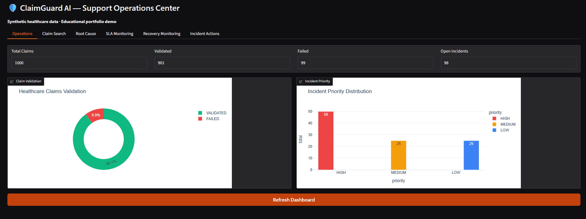
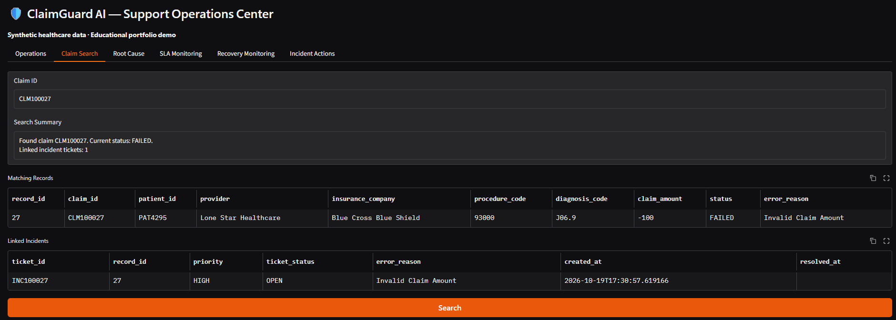
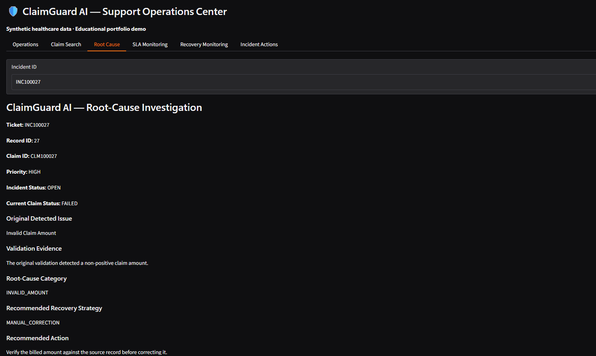
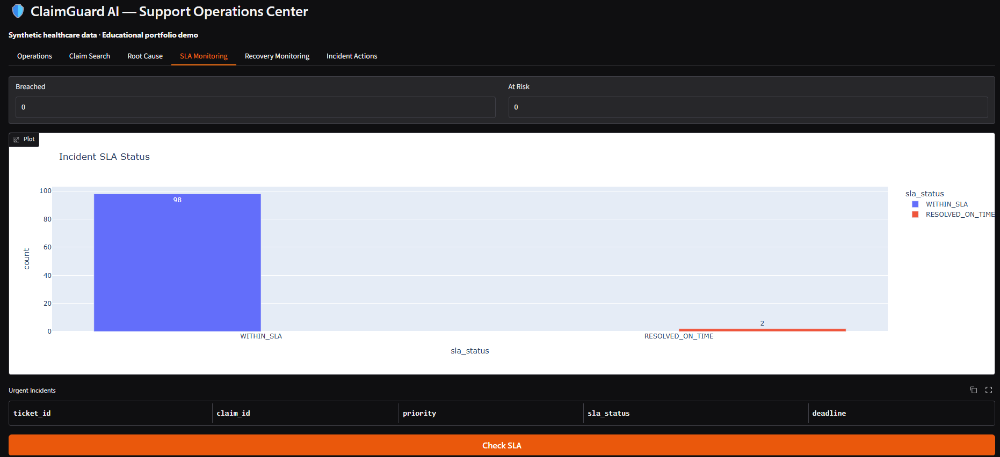
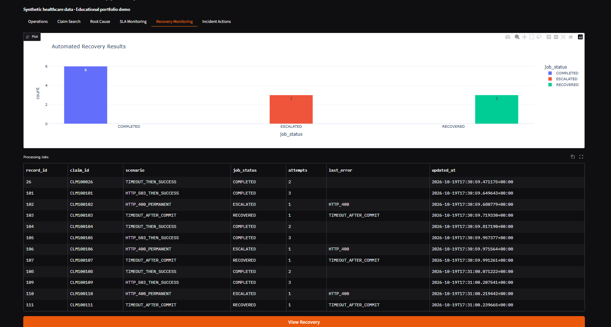
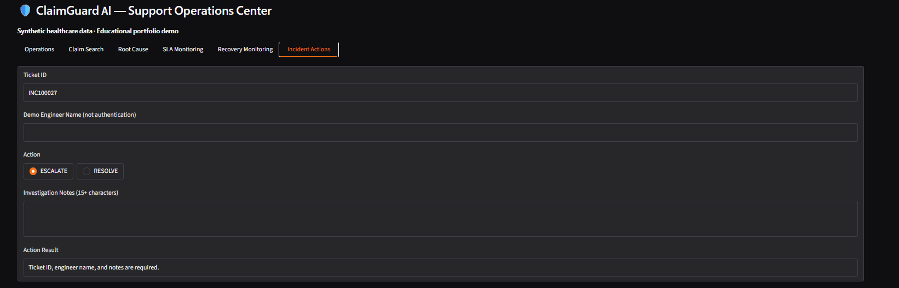

# ClaimGuard-AI-Healthcare-Support-Monitoring
# ClaimGuard AI
### Healthcare Claims Monitoring & Incident Resolution Platform

An interactive healthcare claims monitoring and support engineering prototype developed using **Python, SQL, Gradio, and Plotly**.

ClaimGuard AI simulates healthcare transaction processing, detects validation failures, manages support incidents, monitors SLA deadlines, and demonstrates automated recovery mechanisms.

## Key Features

- **Healthcare Claims Validation:** Detects missing identifiers, invalid claim amounts, unsupported procedure codes, and duplicate claim IDs.
- **Automated Incident Management:** Creates support tickets and assigns priorities based on predefined rules.
- **Root-Cause Investigation:** Provides evidence-based error explanations and recommended corrective actions.
- **SLA Monitoring:** Tracks incident resolution deadlines and identifies overdue tickets.
- **Smart Recovery Engine:** Simulates API failures, bounded retries, exponential backoff, and duplicate-processing prevention.
- **Interactive Dashboard:** Provides claim search, incident investigation, monitoring visualizations, and controlled incident actions.
- **Audit Logging:** Records incident resolutions and transaction replay activities.

## Technology Stack

**Languages:** Python, SQL

**Database:** SQLite

**User Interface:** Gradio

**Data Processing:** Pandas, NumPy

**Visualization:** Plotly

**Development Environment:** Google Colab

## Demonstration Results

Using a dataset of 1,000 synthetic healthcare claims:

| Metric | Result |
|---|---|
| Total synthetic claims | 1,000 |
| Initial validation failures detected | 100 |
| Automatically generated incident tickets | 100 |
| Claims validated after demonstration correction | 901 |
| Simulated processing jobs | 12 |
| Successful simulated processing outcomes | 9 |
| Escalated simulated processing jobs | 3 |

All results are based on synthetic data and controlled test scenarios.

## How to Run

1. Download or open `SDS_demo_project.ipynb` in Google Colab.
2. Install the required Python dependencies if prompted.
3. Run the notebook cells sequentially.
4. Launch the final Gradio application.
5. Explore the monitoring, investigation, SLA, recovery, and incident-management tabs.

## Project Purpose

This project demonstrates practical skills in:

- SQL troubleshooting and relational data management
- Software support and incident investigation
- Healthcare workflow simulation
- API failure handling and retry logic
- Operational dashboards and reporting
- Audit logging and transaction traceability

## Disclaimer

ClaimGuard AI is an independent educational portfolio project. It uses synthetic healthcare data and is not affiliated with Smart Data Solutions or integrated with any real healthcare claims processing system.

It is a functional prototype, not a production-ready healthcare application.

## Application Screenshots

### Operations Dashboard

### Claim Investigation

### Root-Cause Analysis

### SLA Monitoring

### Recovery Monitoring

### Incident Actions

